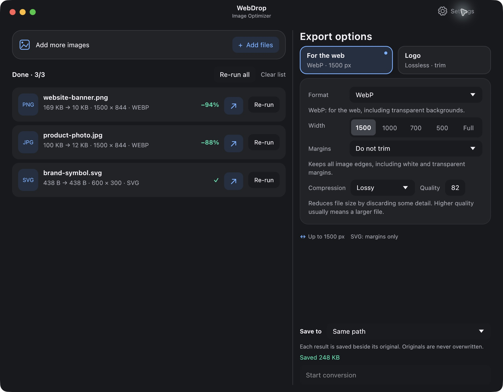
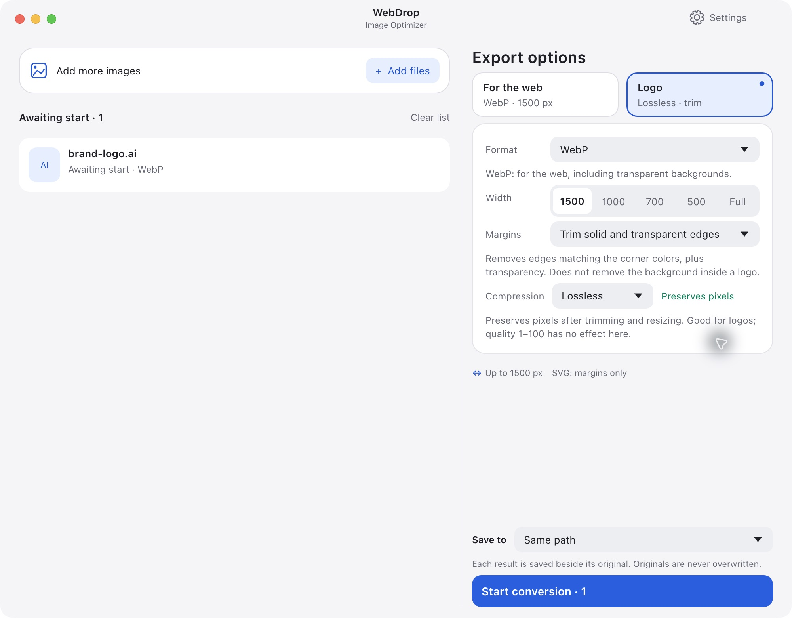

# WebDrop — Image Optimizer

[English](README.en.md) · [Polski](README.md)

**Smaller images. Faster websites. All on your computer.**

Drop your files or folders, choose your settings and start converting — one image or a whole batch.

## ⬇️ Download WebDrop 0.9.2

**Download for your computer — no Rust, terminal or compilation needed.**

| System | Download | After downloading |
| --- | --- | --- |
| 🍎 **macOS 15+ · Apple Silicon** | **[Download for Mac](dist/WebDrop-macOS-arm64.zip?raw=true)** | Unzip, move **WebDrop.app** to **Applications**, then open it |
| 🪟 **Windows 10/11 · x64 · Preview** | **[Download for Windows](dist/WebDrop-Windows-x64.zip?raw=true)** | Extract the **entire ZIP**, then open **WebDrop.exe**; keep the DLLs beside it |
| 🐧 **Linux · x64 · Preview** | **[Download for Linux](dist/WebDrop-Linux-x64.tar.gz?raw=true)** | Extract the archive and launch **WebDrop** |

Windows and Linux builds are **experimental**: cross-compiled on macOS and not yet run on their target operating systems. Linux requires **glibc 2.41+** (e.g. Debian 13), OpenGL, X11 or Wayland, libxkbcommon, and a working desktop portal for file dialogs. These are portable archives, not installers. The macOS build has a local signature; it is not notarized. Windows is not code-signed, so operating-system security prompts may appear.

**All platforms:** PNG, JPG, WebP, AVIF, JPEG XL, and SVG trimming. **macOS only:** AI/PDF, TIFF and HEIC/HEIF import. Mac Intel, Windows ARM and Linux ARM binaries are not included.

[SHA-256 checksums](dist/SHA256SUMS.txt) · [License](LICENSE)

## See WebDrop in action



**One window for the whole batch.** Format, width and compression on the right; results and re-run controls on the left. These are actual results from sample files — savings vary with the image and settings.

[🍎 Download for Mac](dist/WebDrop-macOS-arm64.zip?raw=true) · [🪟 Windows preview](dist/WebDrop-Windows-x64.zip?raw=true) · [🐧 Linux preview](dist/WebDrop-Linux-x64.tar.gz?raw=true)

A small desktop app for macOS, Windows and Linux for local image optimization and batch conversion to WebP, AVIF and JPEG XL. Built in Rust with egui/eframe. No accounts, server or image uploads.

The default export is **WebP, up to 1500 px wide, quality 82**, saved to **Downloads**. Add your files, adjust the settings, then click **Start conversion**. Adding files never starts processing automatically.

## Features

- Drag and drop images or entire folders (including subfolders), use the file picker, or open images through Finder’s **Open With → WebDrop**.
- Optimize PNG, JPEG and WebP; import and export AVIF and JPEG XL.
- Import PDF-compatible Illustrator files, PDF, TIFF and HEIC/HEIF using macOS frameworks.
- Resize to a maximum width of **1500, 1000, 700 or 500 px**, or keep the original dimensions. Aspect ratio is preserved; smaller images are not enlarged.
- Trim transparent or solid-color margins before resizing, including margins around logos.
- Keep SVG files as SVG, with optional canvas trimming only. No SVG optimization or rasterization.
- Remove source metadata from raster outputs, including EXIF, GPS, XMP, IPTC and embedded ICC profiles, after applying orientation and color conversion.
- Save to Downloads, beside each source file, or in a custom folder. The destination is remembered between launches.
- Re-run individual files, several chosen files, or the entire batch with new settings, using the originals.
- Preserve source files and previous results. Name collisions receive a numeric suffix.
- Polish and English interfaces, with the system language selected by default.

## Getting started

Download the archive for your system from the table above and extract it. Open the application inside.

1. Drop files or folders into the left column, click **Choose files**, or press **⌘O** on Mac or **Ctrl+O** elsewhere.
2. Choose the format, width, margins, compression and destination in the right column.
3. Click **Start conversion**. The app captures the settings and destination at this point.
4. Click **↗** beside a result to open its location. Click a filename to see its details, encoder, output path or full error message.

Files added while a batch is running wait for another explicit start. Changing settings does not alter jobs already submitted. Cancellation applies to the current batch and is checked between processing stages; an active encoder call finishes before cancellation takes effect.

After a batch finishes, use **Re-run** beside a file or **Re-run all** above the list. You can prepare several files by clicking **Re-run** beside each one. Adjust the options and click **Start conversion** again. Previous outputs remain on disk.

**Whole folders:** supported images are collected recursively in the background, with an option to cancel. Entries whose names start with a dot, symbolic links found inside folders and unsupported formats are skipped. Overlapping folders do not duplicate files already waiting in the queue. Unreadable entries are reported while accessible images are still added. Start conversion explicitly after scanning finishes. Downloads and Custom path place all results directly in the selected folder without recreating subfolders; Same path saves each result beside its original.

### Presets



*Light mode and the Logo preset: choose trimming and lossless WebP before starting. AI/PDF import is available on macOS.*

| Preset | Settings |
| --- | --- |
| **For the web** | Lossy WebP, quality 82, maximum width 1500 px, no trimming |
| **Logo** | Lossless WebP, maximum width 1500 px, solid-background and transparent-margin trimming |

“Lossless” describes encoding of the prepared pixels. It does not make resizing, rasterization or color-space conversion lossless. A lossless WebP can be smaller than a lossy one for some logos; no encoder or quality setting produces the smallest file for every image.

### Output destination

Use **Save to** above the start button:

| Option | Behavior |
| --- | --- |
| **Downloads** | The default Downloads folder |
| **Same path** | Each result is saved beside its original, even when a batch contains files from different folders |
| **Custom path** | Choose a folder in the native file dialog; use **Choose…** to change it |

The app remembers both the selected mode and the last custom path. Cancelling the folder picker leaves the previous choice intact. Selecting Custom path again restores the previously chosen folder.

The destination is captured separately for each file when you start a batch. A later change applies to the next start, including a re-run. If the chosen folder cannot be used, the app reports an error instead of silently switching to Downloads.

For example, with the default destination:

```text
photo.png → ~/Downloads/photo.webp
            ~/Downloads/photo (1).webp  # if the first name already exists
```

Writes are atomic and do not overwrite existing files, including when multiple app instances produce the same name. The CLI’s `--output` option is independent of GUI preferences.

## Formats and compression

| Output | Options / engine |
| --- | --- |
| **WebP** | libwebp: lossy, lossless or near-lossless encoding; lossless alpha |
| **AVIF** | libavif + AOM: lossy or lossless, 4:4:4 color, lossless alpha |
| **JPEG XL** | libjxl: lossy or lossless, lossless alpha, preservation of invisible RGB values |
| **PNG** | Lossless OxiPNG; lossy libimagequant palette reduction followed by OxiPNG; or lossless OxiPNG + Zopfli |
| **JPG** | MozJPEG progressive encoding; transparency is composited onto white |
| **Original** | Keeps PNG/JPG/WebP/AVIF/JXL; exports AI/PDF/TIFF/HEIC as WebP. SVG always stays SVG |

Quality values are not equivalent between codecs. The lossless WebP, AVIF and JXL modes ignore the quality slider. Near-lossless WebP uses it to control how much pixel detail is retained. **More thorough compression** increases encoding effort; Zopfli can take noticeably longer.

Resizing uses Lanczos3 in linear light with premultiplied alpha to avoid dark edges. Little CMS handles supported embedded color profiles before export to sRGB. Rust dependency versions are recorded in [Cargo.lock](Cargo.lock); native AVIF/JXL libraries come from Homebrew on macOS, Debian packages on Linux, and MSYS2 packages on Windows. Portable archives include `native-packages.json` with package URLs and checksums.

### AI/PDF, TIFF and HEIC imports

Available only in the macOS build. Import uses macOS Image I/O and Core Graphics. No separate converter is needed by the packaged app.

- AI/PDF pages are rasterized onto a transparent background in sRGB, at **300 DPI** by default. Import settings offer 72, 144, 300 and 600 DPI, plus a page/artboard number.
- Multipage TIFF supports page selection. HEIC uses the primary image and ignores auxiliary depth images.
- **AI files must contain PDF-compatible data**, usually saved with Illustrator’s **Create PDF Compatible File** option. Older PostScript-based AI files or files without embedded PDF data must first be saved in a compatible form or exported to PDF.
- The app detects Illustrator’s standard warning page instead of converting it as artwork. It imports the visible embedded document, not editable Illustrator layers.
- Password-protected documents require an unlocked copy. Reduce DPI for very large pages to stay within the 64-megapixel limit.

To convert a logo, add its `.ai` or `.pdf` file, choose **Logo**, then click **Start conversion**. The result is a trimmed, lossless WebP in the selected destination.

### Trimming margins

- **Do not trim** keeps all edges, including white and transparent margins.
- **Trim transparent edges** crops empty transparent margins. White backgrounds remain.
- **Trim solid and transparent edges** also crops margins matching the corner color when all four corners agree. If the corners differ, only transparent margins are trimmed.

Trimming happens **before resizing**. It removes outside margins, not the background inside a logo. Completely empty or uniform images keep their dimensions. The tolerance setting in **Settings → Import** ranges from 0 to 64, with a default of 8, and controls how small color differences and nearly transparent pixels are treated.

### SVG: trimming only

**SVG always remains SVG**, even with WebP selected or the Logo preset enabled. Raster format, width, quality and compression settings do not apply to SVG.

- With trimming disabled, the output is a **byte-for-byte copy**, including metadata.
- With either trimming mode enabled, only the root element’s **`viewBox`, `width` and `height`** may change. Paths, groups, colors, strokes, definitions, comments and metadata retain their original representation.
- Trimming does not rasterize the image, remove white background shapes or apply the raster trim tolerance.
- Bounds include strokes and transforms. Cropping is conservative and rounds outwards; clipping paths may leave extra margins. Empty or already trimmed documents remain unchanged.
- Automatic trimming supports static paths and shapes, groups, local references, gradients and simple CSS classes. Font-dependent text, animations, filters, masks, embedded/external images, nested SVG viewports, responsive CSS and relative geometry dimensions are rejected before writing a result. These SVGs can still be copied with trimming disabled; text can be converted to outlines in an editor first.

SVG input must be valid UTF-8 and stay within the 128 MB / 100,000 XML-node limits. The parser does not fetch external resources. `usvg` is used only to measure bounds; its transformed document is never serialized into the output.

## Metadata, color and limits

Raster outputs are always written without copied EXIF/GPS, XMP/IPTC, comments, author information, dates, thumbnails, DPI metadata or source ICC profiles. This includes **Original** mode, lossless encoding and imports from AI/PDF/TIFF/HEIC. There is no option to retain source metadata. Source files are unchanged; filesystem creation timestamps are separate from image metadata.

Orientation and supported color profiles are applied before metadata is removed. AVIF retains its structural sRGB color description; JXL retains the color parameters required to decode its pixels. These are not copied source metadata. **SVG is the exception**: its contents, including metadata, are preserved, apart from the optional viewport changes described above.

Other limits:

- Static inputs only. Animated PNG, WebP, AVIF and JXL are rejected rather than flattened silently.
- Maximum input size: **128 MB** and **64 megapixels**, per rendered page for documents. WebP has a maximum dimension of **16,383 px** per side.
- AVIF/JXL output is **8-bit SDR sRGB**. Their import paths reject unsupported HDR, profiles and animations. HEIC HDR is exported as an 8-bit SDR image without auxiliary HDR/depth data.
- Images without color-space information are treated as sRGB. Unsupported color configurations are rejected when they cannot be converted safely.
- Trimming and resizing operate at 8 bits per channel. Lossless PNG without trimming or resizing preserves 16-bit precision, including supported ICC conversion.
- Conversion can produce a larger file. The UI reports the actual output size, including increases.

## Interface and preferences

Files appear on the left and export options on the right. The right column requires no scrolling; the file list can scroll. **Settings**, with a gear icon, is available in the top-right corner or through **⌘,**.

The interface uses **egui/eframe**, with native file/folder dialogs, San Francisco on macOS and bundled egui fonts on Windows/Linux. Its controls are custom drawn, not SwiftUI/AppKit or Liquid Glass controls. The system font is loaded locally and is not distributed with the app. The default window is 1000 × 780 px; the minimum is 920 × 720 px.

In **Settings → General → Language**, choose **System**, **Polski · PL** or **English · EN**. System mode selects Polish for a Polish system language and English otherwise. The choice takes effect immediately and is remembered. Native dialogs use the system language; filenames and paths are never translated.

Language and output destination persist between launches. Export settings and appearance return to their defaults. Preferences use the macOS domain `local.imageoptimizer.desktop`, with keys `InterfaceLanguage` and `OutputDestination`. Windows and Linux use `preferences.json` in the user configuration directory (`%APPDATA%/ebest/WebDrop/config` on Windows and `$XDG_CONFIG_HOME/webdrop` or `~/.config/webdrop` on Linux).

## Building from source

Build requirements:

- macOS and Xcode Command Line Tools
- Rust **1.95 or newer**
- Homebrew libraries: `libavif` and `jpeg-xl`
- Python 3 for packaging scripts

From the repository directory:

```sh
brew install libavif jpeg-xl
./scripts/cargo.sh test --locked
./scripts/cargo.sh run --release
./scripts/bundle.sh
open "dist/WebDrop.app"
```

`scripts/cargo.sh` uses a project-local toolchain in `.tools` when present, otherwise the system Cargo installation. Set `WEBDROP_BREW_PREFIX` if Homebrew is installed outside its usual location.

The bundle script creates `dist/WebDrop.app`, generates its icon, copies native codec libraries into `Contents/Frameworks`, rewrites their library paths, includes license notices and applies a local ad-hoc signature. The packaged app does not require Homebrew. Developer ID signing and notarization are separate from this build workflow.

The current bundle requires **macOS 15 or newer**, based on the native libraries used to build it. The script derives the minimum system version from the bundled libraries. An Apple Silicon build is for Apple Silicon; build locally on an Intel Mac for that architecture.

### Windows and Linux cross builds

The cross-build scripts run on **Apple Silicon macOS** with Rust, `rustup`, Python 3 and Xcode Command Line Tools. They fetch pinned Zig 0.15.2 plus SHA-256-verified Debian 13/MSYS2 packages into `.tools/cross`. Package versions and URLs are recorded in each archive. Windows uses the GNU target; Linux uses glibc 2.41. C-code fallbacks avoid requiring AVX-512.

```sh
./scripts/prepare-cross.sh
./scripts/build-cross.sh linux
./scripts/build-cross.sh windows
./scripts/cargo.sh fetch --locked
./scripts/bundle.sh
./scripts/package-release.sh
```

Run the macOS bundle step before packaging: it generates the shared third-party notices. The package script includes the native library dependency closure and licenses, and fails if a required non-system library is missing. Linux uses an `$ORIGIN/lib` RPATH so nested codec dependencies resolve inside the archive. Windows and Linux use a JSON preferences file and their own system file-opening commands. They do not include the macOS-only document decoder.

These scripts produce actual executable archives, but successful cross-compilation does not replace target-system testing. Test GUI launch, drag-and-drop, file dialogs, encoding, preferences and output folders on Windows/Linux before labeling them stable. All download archives and `SHA256SUMS.txt` in `dist` are intentionally included in Git; build caches and the unpacked `.app` are ignored. Keep only the current archives. Upload the repository together with these files for the relative download links above to work on GitHub.

### Validation

```sh
./scripts/cargo.sh fmt --check
./scripts/cargo.sh clippy --locked --all-targets -- -D warnings
./scripts/cargo.sh test --locked
```

Tests cover encoders, AVIF/JXL lossless RGBA round-trips, lossy quality, metadata removal, orientation and color conversion, transparency, 16-bit PNG, resizing, trimming, corrupt input, cancellation, concurrent filename collisions and native AI/PDF/TIFF/HEIC imports. SVG tests check byte preservation, viewport-only changes, unsupported cases and rendered output using the test-only `resvg` dependency.

GUI logic tests cover explicit start, re-runs, destination capture and persistence, and sidebar layout in Polish and English. Native HEIC tests need access to macOS media services, and preference tests write to a separate test domain. Run these tests outside a restrictive sandbox. Fixtures under `tests/fixtures` are synthetic and contain no user data; generators are in `scripts/make-test-fixtures.swift` and `scripts/make-modern-fixtures.c`.

## Command-line mode

The same engine is available without the GUI. `--batch` starts processing immediately; `--output` defaults to Downloads and does not use the saved GUI destination.

```sh
# Default WebP batch: maximum width 1500 px, quality 82
./scripts/cargo.sh run --release -- --batch photo.png photo.jpg

# Resize and choose quality
./scripts/cargo.sh run --release -- --batch --width 700 --quality 85 photo.jpg

# Lossless PNG with Zopfli; preserve original dimensions
./scripts/cargo.sh run --release -- --batch --format png --png-mode zopfli --width 0 artwork.png

# Lossless WebP in a custom folder
./scripts/cargo.sh run --release -- --batch --webp-mode lossless --output /tmp/webdrop-output artwork.png

# Trim an Illustrator logo, or render page 2 of a PDF
./scripts/cargo.sh run --release -- --batch --trim background --webp-mode lossless logo.ai
./scripts/cargo.sh run --release -- --batch --trim transparent --vector-dpi 300 --page 2 logo.pdf

# AVIF and JPEG XL
./scripts/cargo.sh run --release -- --batch --format avif --quality 75 photo.jpg
./scripts/cargo.sh run --release -- --batch --format jxl --quality 85 photo.jpg
./scripts/cargo.sh run --release -- --batch --format avif --avif-lossless --trim transparent logo.png
./scripts/cargo.sh run --release -- --batch --format jxl --jxl-lossless --trim background logo.ai

# Import other formats, or trim an SVG without converting it
./scripts/cargo.sh run --release -- --batch photo.heic scan.tiff photo.avif photo.jxl
./scripts/cargo.sh run --release -- --batch --trim transparent logo.svg

./scripts/cargo.sh run --release -- --help
```

A failed file does not stop the rest of a batch, but it causes a nonzero exit code. CLI diagnostics, conversion summaries and notes are always in English, regardless of the system or GUI language. Filenames and paths remain unchanged.

## Author and license

**Jędrzej Czarnecki** · [info@ebest.pl](mailto:info@ebest.pl) · [ebest.pl](https://ebest.pl)

WebDrop is free and open-source software under **GNU GPL v3 or later**. See [LICENSE](LICENSE) for the terms, including source-code obligations when distributing the software. The software is provided without warranty.

Dependencies retain their own licenses, including libimagequant’s GPL-3.0-or-later license. The app bundle includes third-party notices, accessible from **Settings → About**.
