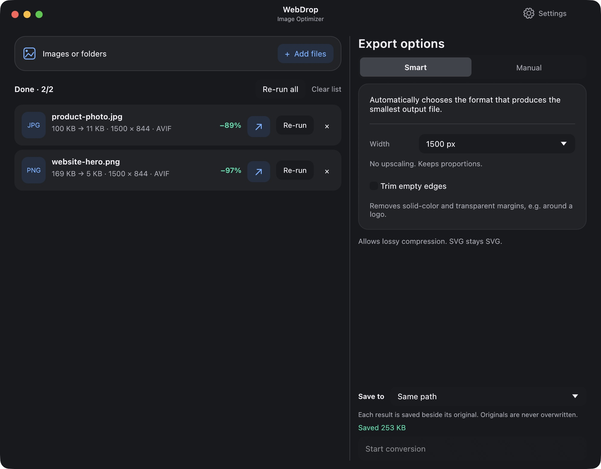
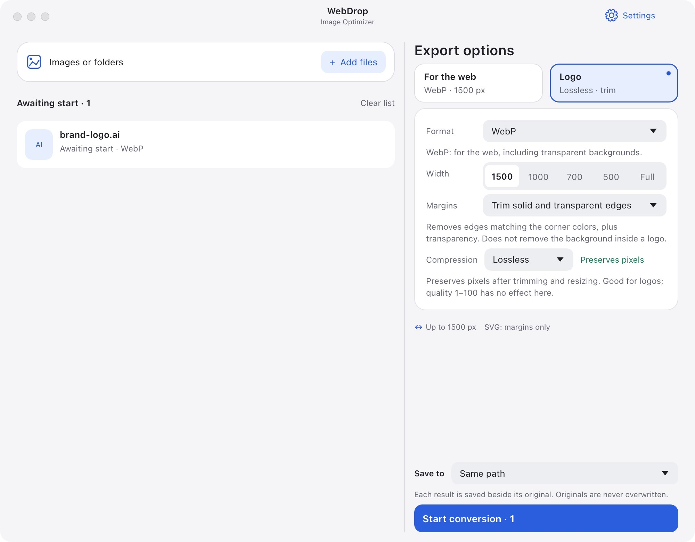

# WebDrop — Image Optimizer

[English](README.md) · [Polski](README.pl.md)

Optimize images and convert whole folders for the web. Free, local, no uploads.

## ⬇️ Download

| System | Download | Install |
| --- | --- | --- |
| 🍎 macOS 15+ · Apple Silicon | **[Download for Mac](dist/WebDrop-macOS-arm64.pkg?raw=true)** | Open the .pkg installer; WebDrop goes to Applications |
| 🪟 Windows 10/11 · x64 | **[Download for Windows](dist/WebDrop-Windows-x64-Setup.exe?raw=true)** | Run Setup.exe, then open WebDrop from Start |
| 🐧 Linux · x64 | **[Download for Linux](dist/WebDrop-x86_64.AppImage?raw=true)** | Allow executing the AppImage in file properties, then open it |

**Version 0.9.4.** Windows/Linux are preview builds, not yet tested on those systems. Linux requires glibc 2.41+, OpenGL, X11/Wayland, libxkbcommon a desktop portal and FUSE. macOS is not notarized; Windows is unsigned.

[SHA-256 checksums](dist/SHA256SUMS.txt)



## How to use

1. Drop images or folders into the window. Subfolders are included.
2. Click **Start conversion**. Smart mode picks the format for you.
3. Find the results in **Downloads**, or choose the source folder or a custom location.

Defaults: **Smart · up to 1500 px wide**. Optional: change the width or enable **Trim empty edges** for logos. Originals are kept by default. Choose **Save to → Overwrite originals** to replace same-format sources; format conversions keep the source. Use **Re-run** to process the same files with different settings.

## Features

- **Formats:** PNG, JPG, WebP, AI, PDF, EPS, TIFF, HEIC, SVG, AVIF and JPEG XL.*
- **Resize:** presets or a custom width, keeping proportions; no upscaling.
- **Smart format:** automatically compares suitable PNG, WebP, JPG and AVIF variants for photos or graphics. Enable a more exhaustive comparison in Settings, or choose a format manually. JPEG XL is optional in Settings. Saves only the smallest completed result at the chosen dimensions; preserves transparency. Includes lossy modes.
- **Auto PNG:** compares lossless compression with a high-quality palette at the chosen size. Keeps the smaller file, then applies Zopfli. Colors may change slightly; lossless modes are also available.
- **Logo preset:** lossless WebP with **trim** — removes transparent or solid-color outer margins, not the background inside a logo.
- **Hybrid mode:** AI/PDF/EPS → SVG; raster images → WebP.
- **SVG stays SVG:** no optimization or conversion; optional canvas trimming only.
- **Privacy:** raster outputs always have source metadata removed, including EXIF and GPS. Existing SVG contents are preserved.
- **Interface:** English/Polish, light/dark themes, remembered output folder.

*AI must be PDF-compatible. TIFF/HEIC and AI/PDF rasterization are macOS-only. Windows/Linux need MuPDF (`mutool` in PATH) for AI/PDF → SVG, plus Ghostscript for EPS. Both tools are bundled on macOS.*



<details>
<summary>Build from source (macOS)</summary>

Requires Rust 1.95+, Xcode Command Line Tools and Python 3. Built with Rust and egui/eframe.

```sh
brew install libavif jpeg-xl mupdf-tools ghostscript
./scripts/bundle.sh
open dist/WebDrop.app
```

[Packaging installers](docs/PACKAGING.md)

</details>

## Author & license

**Jędrzej Czarnecki** · [info@ebest.pl](mailto:info@ebest.pl) · [ebest.pl](https://ebest.pl)

Free and open source under [GPL-3.0-or-later](LICENSE). Third-party licenses are included in the app.
