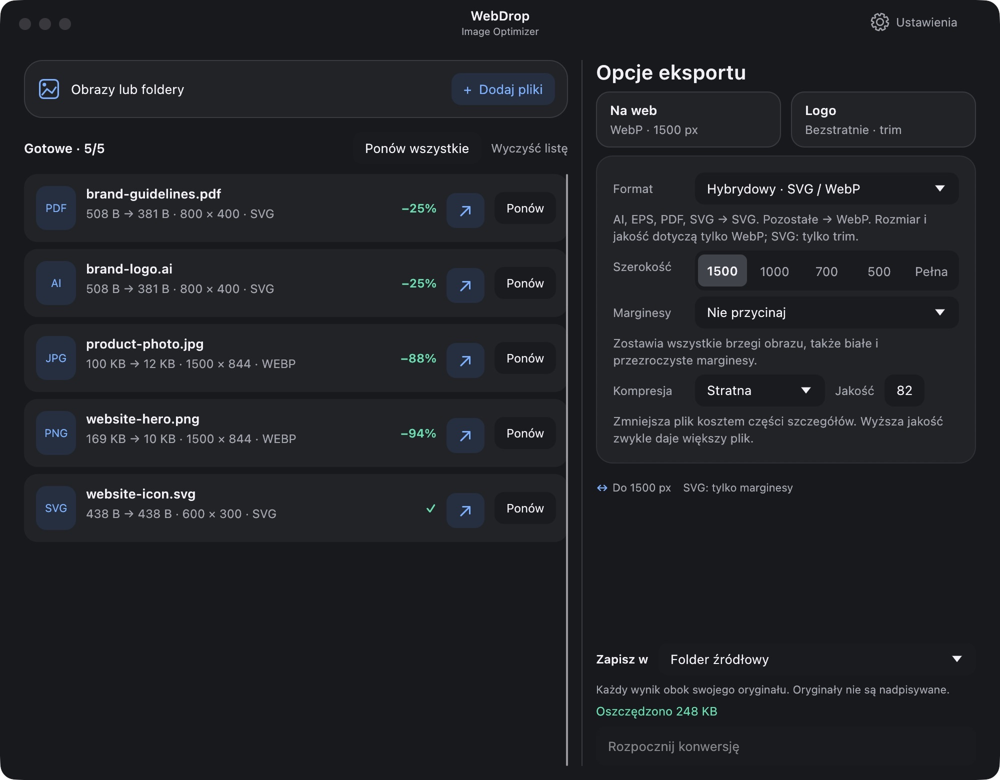
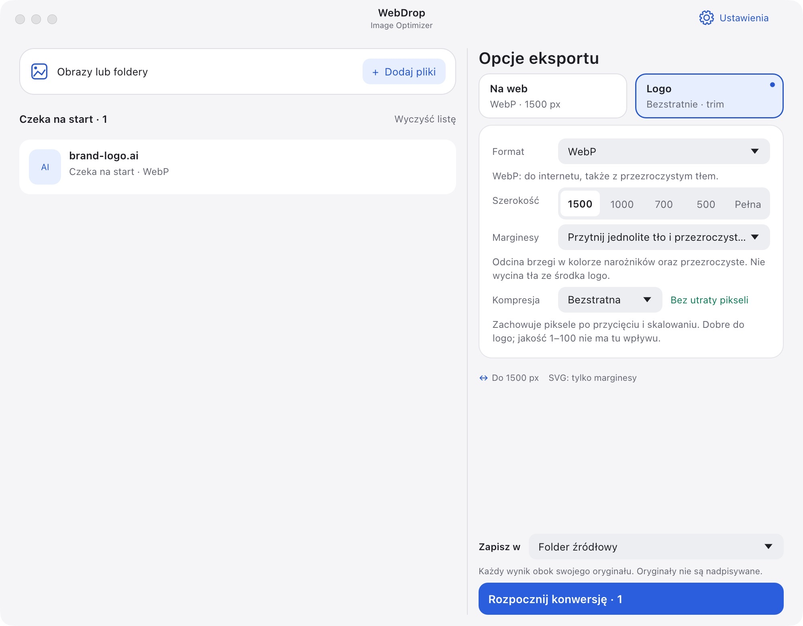

# WebDrop — Image Optimizer

[English](README.md) · [Polski](README.pl.md)

Optymalizuj obrazy i konwertuj całe foldery na potrzeby stron www. Bezpłatnie, lokalnie, bez wysyłania plików.

## ⬇️ Pobierz

| System | Pobieranie | Instalacja |
| --- | --- | --- |
| 🍎 macOS 15+ · Apple Silicon | **[Pobierz na Maca](dist/WebDrop-macOS-arm64.pkg?raw=true)** | Otwórz instalator .pkg; aplikacja trafi do Applications |
| 🪟 Windows 10/11 · x64 | **[Pobierz na Windows](dist/WebDrop-Windows-x64-Setup.exe?raw=true)** | Uruchom Setup.exe, potem WebDrop z menu Start |
| 🐧 Linux · x64 | **[Pobierz na Linux](dist/WebDrop-x86_64.AppImage?raw=true)** | Zezwól na wykonywanie AppImage we właściwościach pliku i otwórz go |

**Wersja 0.9.4.** Windows/Linux to wersje testowe, jeszcze bez testów uruchomienia na tych systemach. Linux wymaga glibc 2.41+, OpenGL, X11/Wayland, libxkbcommon portalu pulpitu i FUSE. macOS nie ma notaryzacji, a Windows podpisu wydawcy.

[Sumy kontrolne SHA-256](dist/SHA256SUMS.txt)



## Jak używać

1. Przeciągnij obrazy lub foldery do okna. Podfoldery też zostaną przeszukane.
2. Wybierz ustawienia i kliknij **Rozpocznij konwersję**.
3. Odbierz wyniki w **Downloads** albo wybierz folder źródłowy lub własny.

Domyślnie: **WebP · do 1500 px szerokości · jakość 82**. Domyślnie oryginały są zachowywane. Opcja **Zapisz w → Nadpisuj oryginały** zastępuje źródła w tym samym formacie; konwersja do innego formatu zachowuje oryginał. Przycisk **Ponów** pozwala przetworzyć te same pliki z innymi ustawieniami.

## Możliwości

- **Formaty:** PNG, JPG, WebP, AI, PDF, EPS, TIFF, HEIC, SVG, AVIF i JPEG XL.*
- **Rozmiar:** gotowe ustawienia lub własna szerokość, z zachowaniem proporcji; bez powiększania.
- **Auto PNG:** porównuje zapis bezstratny i paletę wysokiej jakości przy wybranych wymiarach. Wybiera mniejszy plik i używa Zopfli. Kolory mogą się minimalnie różnić; dostępne są też tryby bezstratne.
- **Preset Logo:** bezstratny WebP i **trim** — przycinanie przezroczystych lub jednolitych marginesów, bez usuwania tła wewnątrz logo.
- **Tryb hybrydowy:** AI/PDF/EPS → SVG; obrazy rastrowe → WebP.
- **SVG pozostaje SVG:** bez optymalizacji i konwersji; opcjonalnie tylko przycięcie obszaru dokumentu.
- **Prywatność:** wyniki rastrowe zawsze bez metadanych źródłowych, w tym EXIF i GPS. Istniejące SVG zachowują swoją zawartość.
- **Interfejs:** polski/angielski, jasny/ciemny motyw, zapamiętywanie folderu wynikowego.

*AI musi być zgodny z PDF. TIFF/HEIC i rasteryzacja AI/PDF działają tylko na macOS. Windows/Linux wymagają MuPDF (`mutool` w PATH) do AI/PDF → SVG oraz Ghostscript do EPS. Na macOS oba narzędzia są dołączone.*



<details>
<summary>Budowanie ze źródeł (macOS)</summary>

Wymagane: Rust 1.95+, Xcode Command Line Tools i Python 3. Aplikacja napisana w Rust z egui/eframe.

```sh
brew install libavif jpeg-xl mupdf-tools ghostscript
./scripts/bundle.sh
open dist/WebDrop.app
```

[Przygotowanie instalatorów](docs/PACKAGING.md)

</details>

## Autor i licencja

**Jędrzej Czarnecki** · [info@ebest.pl](mailto:info@ebest.pl) · [ebest.pl](https://ebest.pl)

Bezpłatna aplikacja open source na licencji [GPL-3.0-or-later](LICENSE). Licencje zależności są dołączone do aplikacji.
